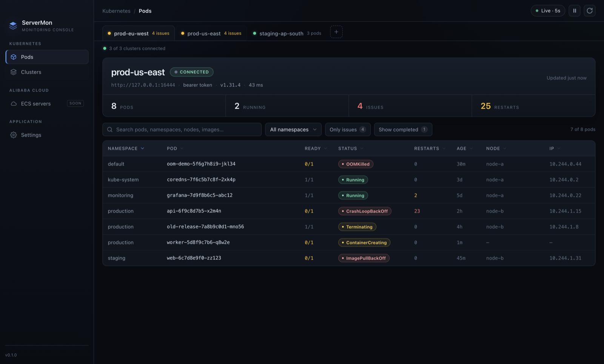
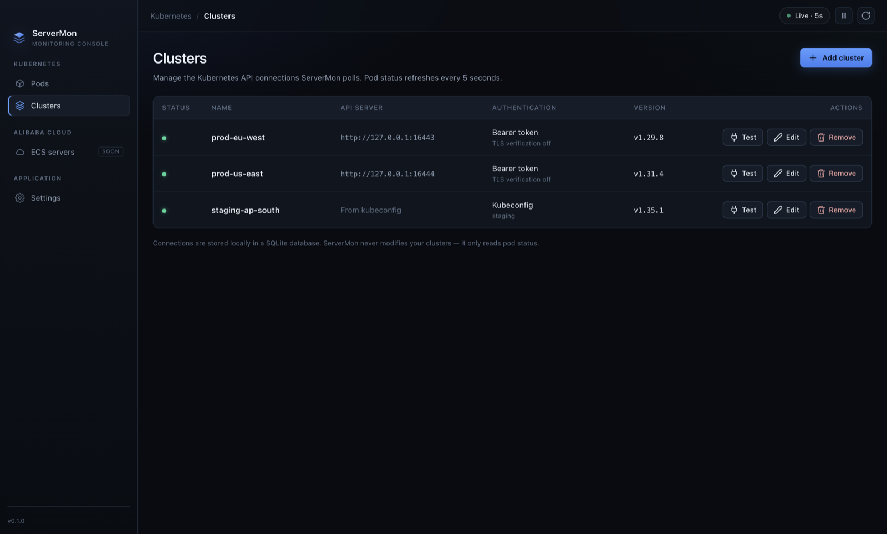
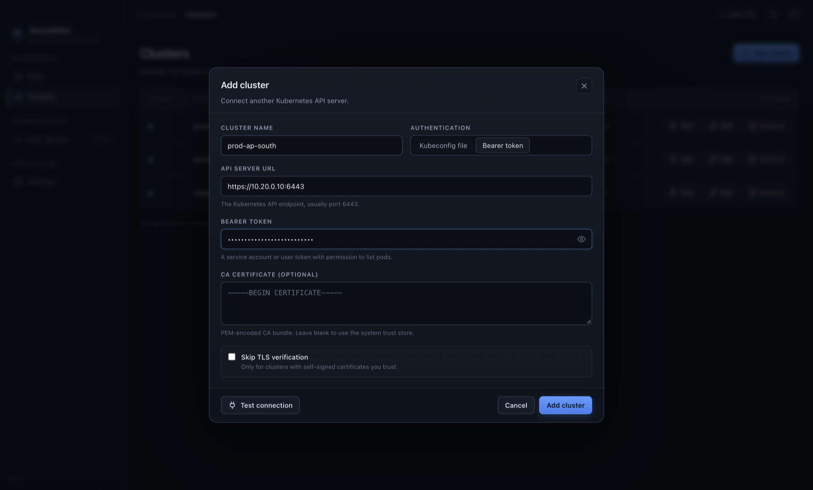
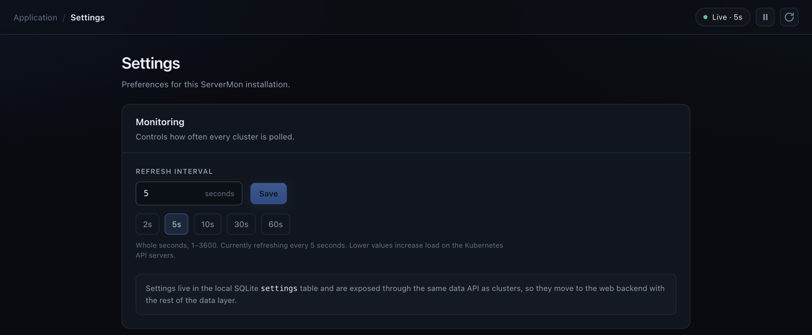
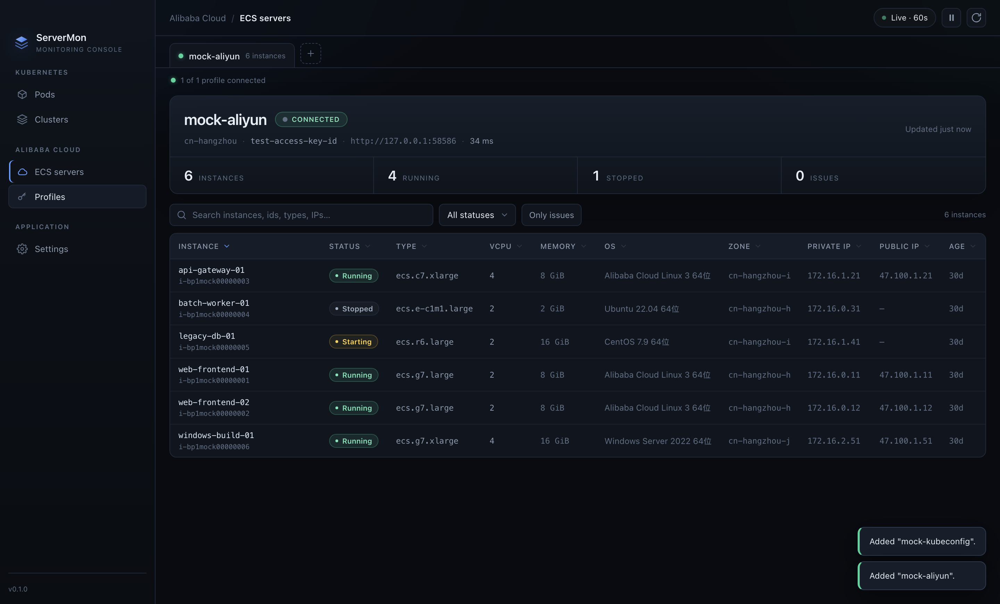
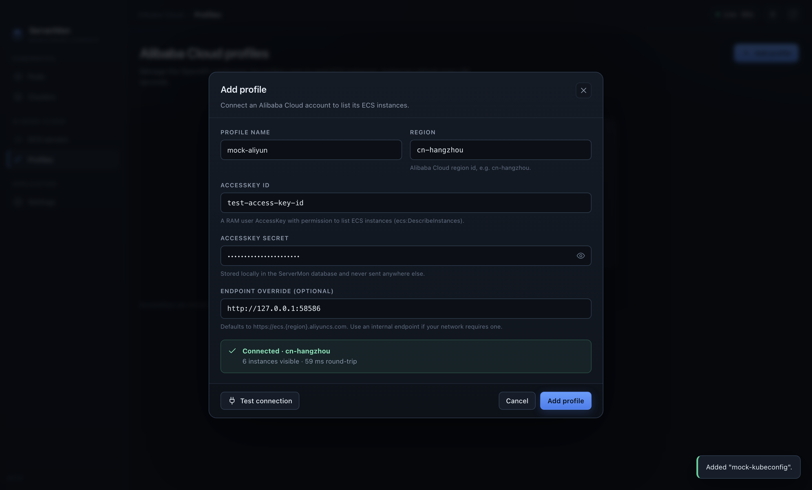
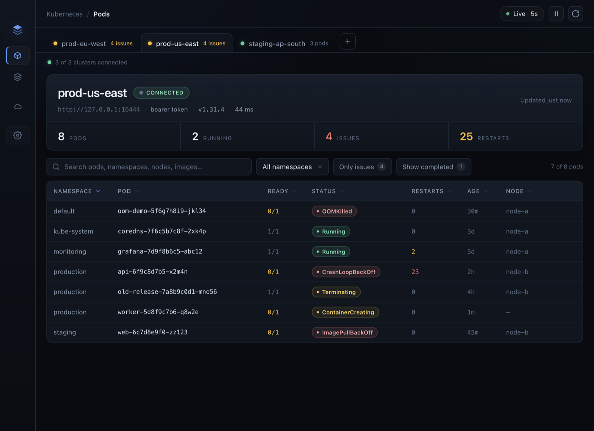

# ServerMon

A desktop monitoring console for multiple Kubernetes clusters **and Alibaba Cloud ECS
accounts**, built with Electron, React, Tailwind CSS, and SQLite. Each connection is polled at a
configurable interval and gets its own tab; connections are managed from a built-in page.

The app is structured as a multi-module console:

- **Kubernetes** → Pods, Clusters
- **Alibaba Cloud** → ECS servers, Profiles

<p align="center">
  
</p>

## Highlights

- **Multiple clusters, one window** — a tab per cluster with live pod and issue counts.
- **Configurable real-time polling** — all clusters refresh in parallel (5 s default, adjustable in
  Settings), with pause and manual refresh. Polling continues on the Clusters page so connection
  indicators stay current.
- **Two authentication methods**
  - Kubeconfig file path (optional context), including exec-based credential plugins used by
    EKS, GKE, and AKS.
  - API server URL + bearer token (+ optional PEM CA bundle or skip-TLS-verification).
- **Cluster management in SQLite** — add, edit, test, and remove connections. Tokens stay in the
  main process and never cross the IPC boundary back to the renderer.
- **Ops-friendly pod table** — kubectl-style statuses (`CrashLoopBackOff`, `ImagePullBackOff`,
  `OOMKilled`, `ContainerCreating`, `Terminating`, `Completed`, …), ready and restart counts,
  node, pod IP, age, search/filter/sort.
- **Failure tolerant** — when a cluster becomes unreachable, the last successful snapshot stays
  visible with an error banner while ServerMon keeps retrying at the configured interval.
- **Kubernetes 1.29 – 1.35** — only stable `v1` core APIs (`GET /version`, `GET /api/v1/pods`) are
  used.
- **Web-ready boundaries** — pages depend on an injected data API interface; SQLite lives behind a
  repository port. Both can be swapped without touching the UI or the use-case layer.
- **Alibaba Cloud ECS via OpenAPI** — list ECS instances through the Alibaba Cloud RPC API
  (`DescribeInstances`) using request signing (Signature Version 1.0) implemented in-process, so no
  heavyweight SDK is required.
- **Multiple Alibaba Cloud profiles** — one profile per account and region. A tab per profile shows
  its instances; profiles are added, edited, tested, and removed from the **Profiles** page.
- **In-app upgrades** — Settings → Application updates checks for a newer version, shows release
  notes and download progress, and can restart/install the update.
- **Persisted preferences** — the refresh interval is stored in the SQLite `settings` table.

## Screenshots

Screenshots were captured against three demo clusters reporting Kubernetes 1.29.8, 1.31.4, and
1.35.1.

<table>
  <tr>
    <td width="50%">
      
      <br>
      <sub><b>Connections</b> — kubeconfig and bearer-token auth with live versions</sub>
    </td>
    <td width="50%">
      
      <br>
      <sub><b>Add a cluster</b> — kubeconfig file, or API server plus token</sub>
    </td>
  </tr>
</table>

<p align="center">
  
  <br>
  <sub><b>Settings</b> — global refresh interval persisted to SQLite, plus application updates</sub>
</p>

<table>
  <tr>
    <td width="50%">
      
      <br>
      <sub><b>ECS servers</b> — instances of the selected Alibaba Cloud profile with status, type, vCPU, memory, OS and IPs</sub>
    </td>
    <td width="50%">
      
      <br>
      <sub><b>Add a profile</b> — AccessKey pair, region, and an optional endpoint override</sub>
    </td>
  </tr>
</table>

<details>
<summary><b>Responsive layout</b> (click to expand)</summary>



</details>

## Requirements

- macOS (tested), Windows, or Linux for the desktop app.
- Node.js 20+ for development.
- Kubernetes credentials allowed to list pods cluster-wide. Example service account RBAC:

```yaml
apiVersion: rbac.authorization.k8s.io/v1
kind: ClusterRole
metadata:
  name: servermon-pod-reader
rules:
  - apiGroups: [""]
    resources: ["pods"]
    verbs: ["get", "list", "watch"]
---
apiVersion: rbac.authorization.k8s.io/v1
kind: ClusterRoleBinding
metadata:
  name: servermon-pod-reader
roleRef:
  apiGroup: rbac.authorization.k8s.io
  kind: ClusterRole
  name: servermon-pod-reader
subjects:
  - kind: ServiceAccount
    name: servermon
    namespace: default
```

## Alibaba Cloud ECS requirements

Create a RAM user with a minimal read-only policy, then add a profile in **Alibaba Cloud →
Profiles** with its AccessKey pair and a region:

```json
{
  "Version": "1",
  "Statement": [
    {
      "Effect": "Allow",
      "Action": "ecs:DescribeInstances",
      "Resource": "*"
    }
  ]
}
```

The AccessKey secret is stored locally in SQLite and never sent to the renderer. ServerMon only
reads instance inventory — it never starts, stops, or modifies an instance.

## Development

```bash
npm install
npm run dev        # Electron + Vite with hot reload
npm run typecheck  # main/preload and renderer TypeScript checks
npm run build      # production build into out/
npm start          # run the production build
npm run demo:images # regenerate the README screenshots (mock Kubernetes clusters)
```

Local helpers for the Alibaba Cloud module:

```bash
npm run mock:aliyun      # mock ECS OpenAPI server (validates the request signature)
npm run verify:signature  # check the RPC signing against Alibaba Cloud's documented example
```

If the Electron binary was not downloaded by `npm install` (npm 11 can skip install scripts):

```bash
node node_modules/electron/install.js
# or, if GitHub is slow:
ELECTRON_MIRROR=https://npmmirror.com/mirrors/electron/ node node_modules/electron/install.js
```

Package the app for the current platform:

```bash
npm run dist                        # macOS bundle -> dist/
npx electron-builder --win --x64    # Windows (NSIS installer)
npx electron-builder --linux --x64  # Linux (AppImage)
```

Releases are built and attached to the GitHub release automatically — see
[Releasing](#releasing).

## Releasing

`.github/workflows/release.yml` builds installers for macOS, Windows, and Linux and attaches them
to the GitHub release that triggered it. Publish a release in the GitHub UI, or:

```bash
gh release create v0.2.0 --title v0.2.0 --notes 'What changed'
```

The workflow uploads:

| Platform | Assets |
| --- | --- |
| macOS | `ServerMon-<version>-arm64.dmg` / `-x64.dmg`, matching `.zip` files, blockmaps, `latest-mac.yml` |
| Windows | `ServerMon-<version>-x64.exe` (NSIS), blockmap, `latest.yml` |
| Linux | `ServerMon-<version>-x64.AppImage`, blockmap, `latest-linux.yml` |

Notes:

- The matrix is `macos-latest` (builds `x64` and `arm64` in one job so a single `latest-mac.yml`
  lists both), `windows-latest`, and `ubuntu-latest`. Platforms build in parallel and
  `fail-fast: false` keeps one platform from cancelling the others.
- The version comes from the release tag (`v0.2.0` → `0.2.0`), so `package.json` does not have to
  match the tag beforehand.
- CI passes `--publish never` and uploads with `gh release upload --clobber`, keeping the asset list
  deterministic. electron-builder still writes `app-update.yml` into the bundle and the
  `latest-*.yml` update metadata into `dist/`, which the in-app updater needs.
- Run the workflow manually from the Actions tab (`workflow_dispatch`) to rebuild an existing tag.

### Optional code signing

Builds are unsigned unless you add these repository secrets. Nothing else needs changing.

| Secret | Purpose |
| --- | --- |
| `MAC_CERTIFICATE` | base64-encoded Developer ID Application `.p12` |
| `MAC_CERTIFICATE_PASSWORD` | password for the `.p12` |
| `APPLE_ID`, `APPLE_APP_SPECIFIC_PASSWORD`, `APPLE_TEAM_ID` | notarization credentials |
| `WIN_CERTIFICATE` | base64-encoded Authenticode `.pfx` |
| `WIN_CERTIFICATE_PASSWORD` | password for the `.pfx` |

macOS signing and notarization activate only when `MAC_CERTIFICATE` and `APPLE_ID` are both set;
Windows signing only when `WIN_CERTIFICATE` is set. Encode a certificate for the secret with:

```bash
base64 -i path/to/cert.p12 | pbcopy     # macOS
base64 -w0 path/to/cert.pfx             # Linux
```

## Usage

1. Open **Kubernetes → Clusters → Add cluster**.
2. Choose an authentication method:
   - **Kubeconfig file** — path on this machine (e.g. `~/.kube/config`) and optionally a context.
   - **Bearer token** — API server URL (e.g. `https://10.0.0.10:6443`) plus a token. Paste a PEM CA
     bundle for private CAs, or enable **Skip TLS verification**. Plain `http://` endpoints
     require skip-TLS-verification (an upstream Kubernetes client policy).
3. **Test connection** verifies credentials and reports the server version, then save.
4. Switch to **Kubernetes → Pods**. All clusters are polled at the interval configured in
   Settings (5 seconds by default). Use the pause/play
   button for global auto-refresh, the refresh button to fetch immediately, or per-tab filters to
   narrow the pod table.
5. Editing or removing a connection only changes ServerMon's local configuration; the cluster is
   never modified.

To monitor Alibaba Cloud:

1. Open **Alibaba Cloud → Profiles → Add profile**.
2. Enter a profile name, a region (e.g. `cn-hangzhou`), an AccessKey ID, and the AccessKey secret.
   The endpoint override is optional — it defaults to `https://ecs.{region}.aliyuncs.com`.
3. **Test connection** signs a `DescribeInstances` request and reports the number of visible
   instances, then save.
4. Switch to **Alibaba Cloud → ECS servers**. Every profile gets a tab; the active tab lists the
   instances of that profile with status, instance type, vCPU, memory, OS, zone, and IP addresses.

## UI layering and the data API

The page layer never talks to Electron IPC, SQLite, or Kubernetes directly.

```
Pages / components
      │  useApi() → ServermonApi interface (src/shared/api.ts)
      ▼
ApiProvider (React context)
      │
      ▼
Adapter: createElectronApi() → preload → IPC → main process
         (future) createHttpApi() → Next.js route handlers
```

- **`src/shared/api.ts`** defines `ServermonApi`, the contract every page depends on.
- **`src/renderer/src/data/ApiContext.tsx`** injects the implementation via `<ApiProvider api={…}>`
  and exposes `useApi()`.
- **`src/renderer/src/data/electronApi.ts`** is the desktop adapter (Electron IPC). A web
  deployment adds an equivalent `fetch()` adapter and passes it to `ApiProvider`; pages do not
  change.
- The preload bridge exposes only this interface (`contextIsolation: true`,
  `nodeIntegration: false`).

Suggested REST mapping for the future web app:

| `ServermonApi` method | REST endpoint |
| --- | --- |
| `listClusters()` | `GET /api/clusters` |
| `createCluster(input)` | `POST /api/clusters` |
| `updateCluster(id, input)` | `PUT /api/clusters/:id` |
| `deleteCluster(id)` | `DELETE /api/clusters/:id` |
| `testCluster(input, id?)` | `POST /api/clusters/test` |
| `listPods(clusterId)` | `GET /api/clusters/:id/pods` |
| `listEcsProfiles()` | `GET /api/ecs/profiles` |
| `createEcsProfile(input)` | `POST /api/ecs/profiles` |
| `updateEcsProfile(id, input)` | `PUT /api/ecs/profiles/:id` |
| `deleteEcsProfile(id)` | `DELETE /api/ecs/profiles/:id` |
| `testEcsProfile(input, id?)` | `POST /api/ecs/profiles/test` |
| `listEcsInstances(profileId)` | `GET /api/ecs/profiles/:id/instances` |
| `getSettings()` | `GET /api/settings` |
| `updateSettings(settings)` | `PUT /api/settings` |
| `getUpdateState()` | `GET /api/updates` |
| `checkForUpdates()` | `POST /api/updates/check` |
| `getAppInfo()` | `GET /api/app` |

## Settings

**Settings → Monitoring** sets two intervals:

- **Kubernetes refresh interval** (1–3600 seconds, key `refresh_interval_seconds`, default `5`) —
  how often every cluster is polled.
- **Alibaba Cloud refresh interval** (10–3600 seconds, key `ecs_refresh_interval_seconds`, default
  `60`) — how often every ECS profile is polled. It is slower by default because the Alibaba Cloud
  OpenAPI is rate limited.

Both values are stored in the SQLite `settings` table and are read through `SettingsService` →
`SettingsRepository` → `SqliteSettingsRepository`. Changing them updates polling immediately and
updates the `Live · Ns` indicator in the title bar.

## Application updates

Settings → Application updates exposes `checkForUpdates`, `downloadUpdate`, and `installUpdate`
(restart + install). The main process wraps **electron-updater** behind the `AppUpdater` port.

Update checks only work in packaged builds. In development the UI reports that updates are
unavailable instead of failing silently.

`electron-builder.yml` already configures a GitHub publish provider, so the bundled `app-update.yml`
points at this repository's releases and the updater reads `latest-mac.yml` / `latest.yml` /
`latest-linux.yml` from the newest release. To ship an update:

1. Create and publish a GitHub release — see [Releasing](#releasing). The workflow aligns the build
   version with the tag and uploads the installers plus their `latest-*.yml` metadata.
2. Users on an older build are offered the new version under Settings → Application updates.

Keep the `dmg`, `zip`, and `latest-mac.yml` assets together on the release: the `.zip` is what the
macOS updater downloads. macOS updates must be signed with the same Developer ID as the installed
app, so unsigned builds can check and download but cannot install. Set `SERVERMON_UPDATE_URL` at
runtime to point the updater at a generic feed instead of GitHub.

The `AppUpdater` port has no SQL/IPC dependencies, so a web build can implement the same interface
with deployment-version information.

## Backend layers (ports and adapters)

```
src/main/
  domain/            Pure domain types, validation, draft merging, errors
  application/
    ports.ts         ClusterRepository + ClusterMonitor + EcsProfileRepository + EcsMonitor (the ports)
    clusterService.ts      CRUD use cases
    connectionTester.ts    "Test connection" use case
    ecsProfileService.ts   ECS profile CRUD use cases
    ecsConnectionTester.ts ECS "Test connection" use case
  infrastructure/
    sqliteDatabase.ts            open DB + run migrations
    sqliteClusterRepository.ts   ClusterRepository → SQLite
    sqliteEcsProfileRepository.ts EcsProfileRepository → SQLite
    kubernetesClusterMonitor.ts  ClusterMonitor → Kubernetes API
    aliyunOpenApiClient.ts       Alibaba Cloud RPC signing + transport
    aliyunEcsMonitor.ts          EcsMonitor → Alibaba Cloud OpenAPI
  ipc.ts             Transport adapter: IPC → application services
  index.ts           Composition root (the only place that wires concrete classes)
```

`ClusterService`, `ConnectionTester`, and `SettingsService` depend only on the interfaces in
`application/ports.ts`. `SqliteClusterRepository implements ClusterRepository` and
`SqliteSettingsRepository implements SettingsRepository`; `KubernetesClusterMonitor implements
ClusterMonitor`; `ElectronUpdater implements AppUpdater`. To move the backend to Postgres, add a
`PostgresClusterRepository` / `PostgresSettingsRepository` and swap them in the composition root —
no changes to domain logic, IPC, or UI. The same application/domain code can be hosted in Next.js
route handlers.

## Database and migrations

SQLite lives at Electron's per-user data directory:

- macOS: `~/Library/Application Support/ServerMon/servermon.db`
- Windows: `%APPDATA%/ServerMon/servermon.db`
- Linux: `~/.config/ServerMon/servermon.db`

Set `SERVERMON_USER_DATA=/some/dir` to override the location (useful for portable installs and
tests).

Startup runs forward-only migrations from `src/main/infrastructure/sqliteDatabase.ts`:

- A `schema_migrations` table records `version`, `name`, and `applied_at` for every applied
  migration.
- Pending migrations run in version order, each inside its own transaction. A failed migration is
  rolled back and retried on the next launch; earlier successful migrations remain recorded.
- Applied migrations must never be edited. Add a new entry with the next version:

```ts
{
  version: 3,
  name: 'create_aliyun_accounts',
  up: (db) => db.exec(`
    CREATE TABLE aliyun_accounts (
      id INTEGER PRIMARY KEY AUTOINCREMENT,
      name TEXT NOT NULL UNIQUE,
      access_key_id TEXT NOT NULL,
      access_key_secret TEXT NOT NULL,
      region TEXT NOT NULL,
      created_at TEXT NOT NULL,
      updated_at TEXT NOT NULL
    );
  `)
}
```

This is how table changes or new tables (for example the Alibaba Cloud ECS module) are introduced
without breaking existing installs. The current `clusters` table:

```sql
CREATE TABLE clusters (
  id                 INTEGER PRIMARY KEY AUTOINCREMENT,
  name               TEXT NOT NULL COLLATE NOCASE UNIQUE,
  server             TEXT NOT NULL DEFAULT '',
  auth_type          TEXT NOT NULL CHECK (auth_type IN ('kubeconfig', 'token')),
  kubeconfig_path    TEXT,
  kubeconfig_context TEXT,
  token              TEXT,
  ca_cert            TEXT,
  skip_tls_verify    INTEGER NOT NULL DEFAULT 0,
  created_at         TEXT NOT NULL,
  updated_at         TEXT NOT NULL
);

CREATE TABLE ecs_profiles (
  id                INTEGER PRIMARY KEY AUTOINCREMENT,
  name              TEXT NOT NULL COLLATE NOCASE UNIQUE,
  region_id         TEXT NOT NULL,
  access_key_id     TEXT NOT NULL,
  access_key_secret TEXT,
  endpoint          TEXT,
  created_at        TEXT NOT NULL,
  updated_at        TEXT NOT NULL
);

CREATE TABLE settings (
  key        TEXT PRIMARY KEY,
  value      TEXT NOT NULL,
  updated_at TEXT NOT NULL
);

CREATE TABLE schema_migrations (
  version    INTEGER PRIMARY KEY,
  name       TEXT NOT NULL,
  applied_at TEXT NOT NULL
);
```

Migrations shipped so far: `1` (clusters), `2` (settings, seeded with a 5-second refresh
interval), `3` (ecs_profiles), `4` (settings, seeded with a 60-second Alibaba Cloud refresh
interval).

Bearer tokens and AccessKey secrets are stored locally in SQLite. The file is restricted to the current user
(`chmod 600`) and tokens are never sent to the renderer, but the database is not encrypted. Treat
the app-data directory as sensitive. A web deployment should use a server-side secret store instead
of storing cloud credentials in the browser database.

## Styling

The renderer uses **Tailwind CSS v4** via `@tailwindcss/vite`:

- Design tokens (colors, radii, fonts, the `sidebar` breakpoint) live in the `@theme` block of
  `src/renderer/src/styles.css`.
- Layout and page structure use Tailwind utilities directly in JSX.
- Small, repeated primitives (`.btn`, `.icon-btn`, `.status-pill`, `.filter-chip`, inputs,
  modal, toasts) are declared in `@layer components` with `@apply`.
- Tailwind v4 needs no `tailwind.config.js`.

The sidebar collapses to icons below the `sidebar` breakpoint (1240 px); the pod table hides
lower-priority columns on narrower windows.

## Testing

```bash
npm run test:e2e
```

The test builds the app, starts a mock Kubernetes API, launches the real Electron app with an
isolated user-data directory, and verifies:

- adding a token-authenticated cluster and a kubeconfig-authenticated cluster,
- **Test connection** against both auth modes,
- pod status rendering, search, issue/completed filters,
- the configured auto-refresh (5 s default, by counting requests received by the mock API),
- responsive sidebar collapse,
- module navigation between the Kubernetes and Alibaba Cloud modules,
- editing and deleting clusters,
- the settings table (refresh interval persisted and reflected in the UI),
- the update-status UI (the update path reports as unavailable in unpackaged test builds),
- adding an Alibaba Cloud profile, testing it against a mock OpenAPI server, and rendering the
  returned ECS instances (status, type, vCPU, memory, OS, IPs),
- the ECS search filter and multiple profile tabs,
- that the mock OpenAPI server accepted every request signature (no `SignatureDoesNotMatch`),
- the `schema_migrations` history rows.

The mock Alibaba Cloud server verifies the request signature independently of the app, so a signing
bug is caught by the suite.

Screenshots are written to `screenshots/`.

## Project structure

```
src/
  main/
    domain/{cluster,ecsProfile}.ts
    application/{ports,clusterService,connectionTester,ecsProfileService,ecsConnectionTester,settingsService}.ts
    infrastructure/{sqliteDatabase,sqliteClusterRepository,sqliteEcsProfileRepository,sqliteSettingsRepository}.ts
    infrastructure/{kubernetesClusterMonitor,aliyunOpenApiClient,aliyunEcsMonitor,electronUpdater}.ts
    ipc.ts
    index.ts
  preload/index.ts
  renderer/
    src/App.tsx
    src/data/{ApiContext,electronApi}.tsx|ts
    src/components/{Sidebar,TopBar,ClusterTabs,PodsView,PodTable,ConfigPage,ClusterForm,…}
    src/components/{EcsProfileTabs,EcsInstancesView,EcsInstanceTable,EcsProfilesPage,EcsProfileForm,SettingsPage,…}
    src/lib/{navigation,format,pods,ecs,ui,useEcsMonitor}.ts
    src/styles.css
  shared/
    api.ts          ServermonApi contract used by pages
    types.ts        Domain DTOs shared across processes
scripts/
  mock-k8s-server.mjs
  mock-aliyun-ecs-server.mjs
  verify-aliyun-signature.ts
  check-integrity.mjs
  e2e.mjs
  capture-demo.mjs
docs/images/        README screenshots
```

## Notes and limitations

- Polling uses `list pods` on every interval rather than a watch/informer. That is deliberate for a
  dashboard interval and easy multi-version compatibility, but request volume scales with cluster
  count and size. Use pause to reduce load.
- Only bearer-token and kubeconfig authentication are supported; client-certificate auth works via
  kubeconfig.
- Pod CPU/memory usage is not shown because it requires metrics-server and the metrics API.
- The Alibaba Cloud module polls the ECS instance inventory only. CloudMonitor metrics (CPU/memory
  graphs), disks, and networks are not shown.
- The Alibaba Cloud module polls on its own, slower interval and only while the module is on screen,
  so it does not spend API quota in the background.
- ECS instance status is reported as the Alibaba Cloud API returns it (`Running`, `Stopped`,
  `Starting`, …); it is not normalized to Kubernetes-style pod statuses.
- The status column derives from pod phase plus container waiting/terminated reasons; it aims to
  match `kubectl get pods`, not every pod condition.
